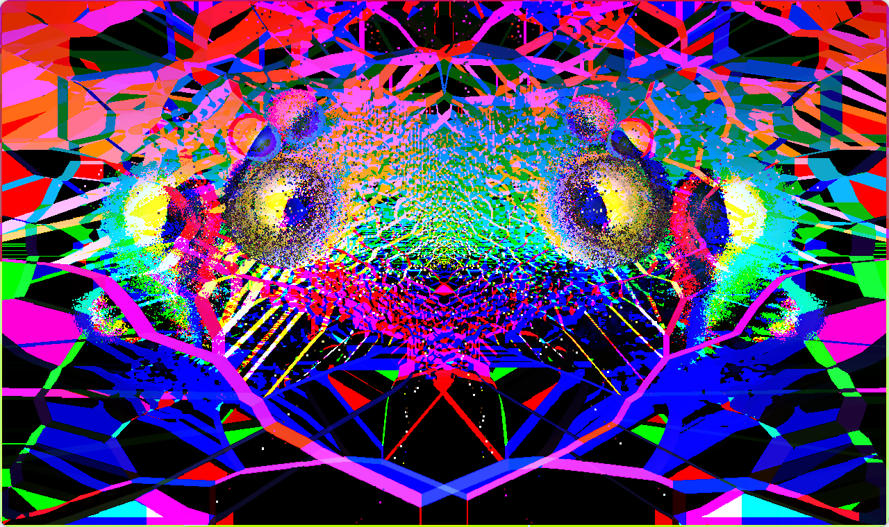
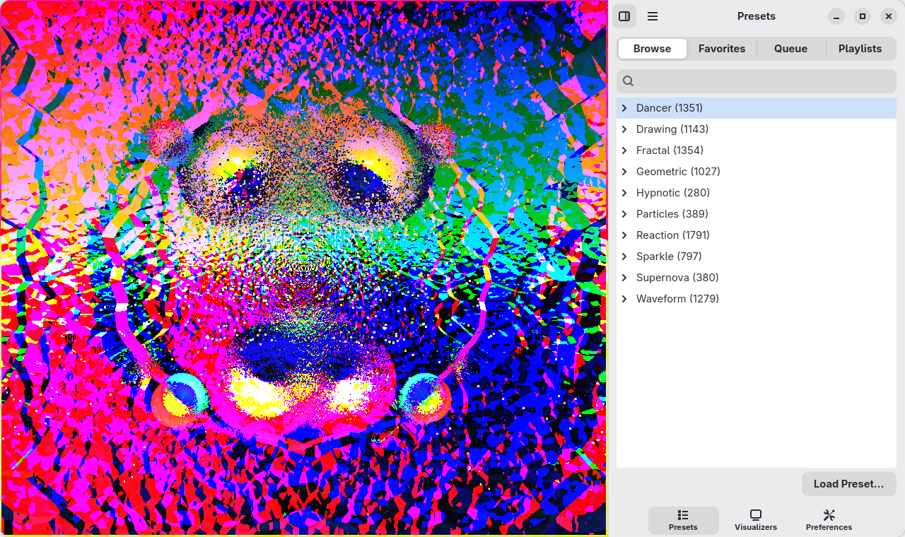
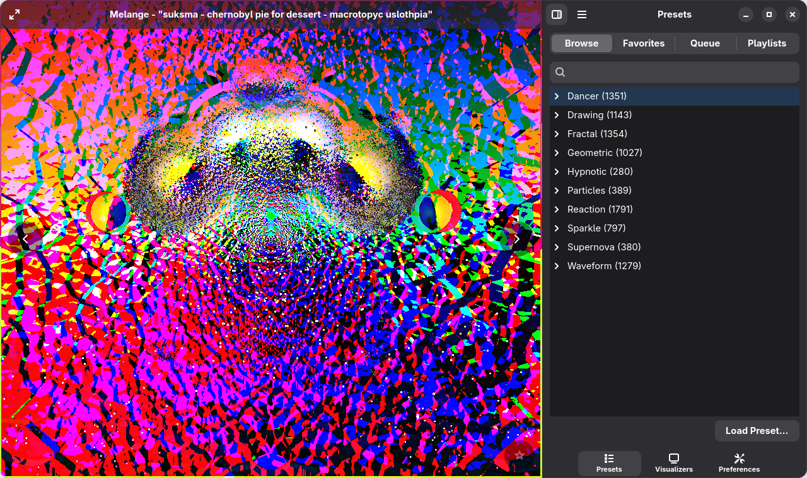
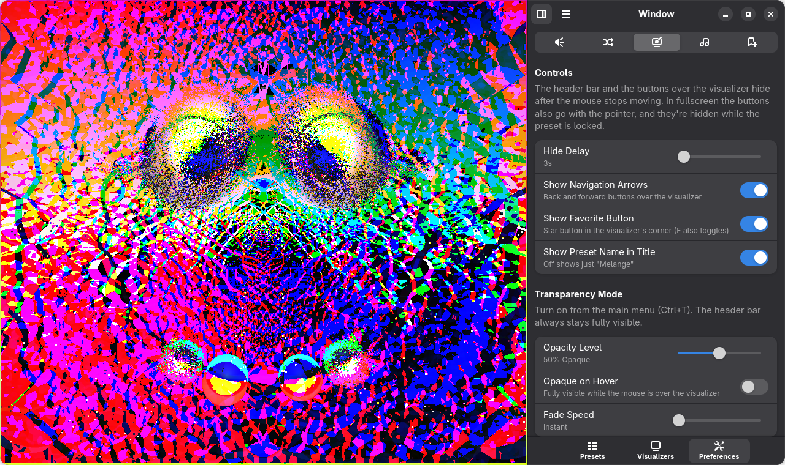
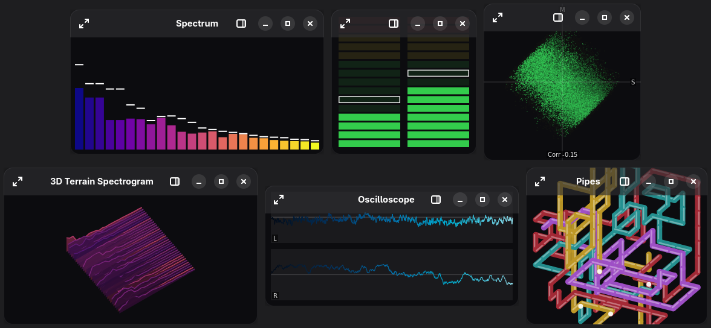
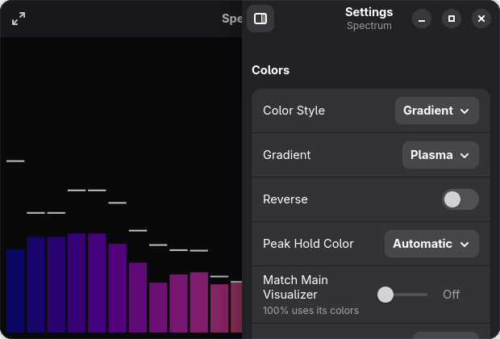

<p align="center">
  
</p>

<h1 align="center">Melange</h1>

<p align="center"><em>A MilkDrop music visualizer for the GNOME desktop.</em></p>

Melange turns whatever your computer is playing into MilkDrop visuals. It
renders natively with [projectM](https://github.com/projectM-visualizer/projectm)
inside a GTK4/libadwaita window, listens to system audio (or a microphone)
through PipeWire, and comes with projectM's curated "Cream of the Crop"
collection of about 9,800 presets. Alongside the main visualizer it can open
small extra windows: meters, scopes, spectrums and other mini visualizers
that react to the same audio.

| Dark | Light |
| --- | --- |
|  |  |

| Preset browser | Preferences |
| --- | --- |
|  |  |



### Features

- **Native MilkDrop rendering.** libprojectM draws straight into the window
  with OpenGL. There's no browser engine in between.
- **About 9,800 presets built in.** projectM's
  [Cream of the Crop](https://github.com/projectM-visualizer/presets-cream-of-the-crop)
  collection and the MilkDrop texture pack, browsable as a Category ›
  Subfolder tree or by search.
- **Your own presets.** Open `.milk` files with Load Preset… (Ctrl+O, the
  main menu or the right-click menu) or drop them onto the window. They're
  listed under Your Presets at the top of the preset browser and are
  remembered between launches.
- **Favorites, a queue and playlists.** Star a preset from the visualizer
  (F) or from the browser, queue up what plays next, and save playlists.
- **A sidebar instead of dialogs.** Presets, Visualizers and Preferences
  open beside the visualizer, so you can see the effect of every change.
  In narrow windows the sidebar covers the visualizer instead.
- **Preset changes your way.** Cycle on a timer (with optional jitter), on
  detected beats, or when the song changes. Set the transition time, shuffle,
  go back and forward through history, lock the current preset (L) or pause
  the picture entirely (P).
- **Fullscreen, Hide Controls and Transparency Mode.** In fullscreen the
  pointer, the header bar and the floating buttons hide together after two
  seconds without movement. Hide Controls (Ctrl+I) hides the header bar and
  floating buttons. Transparency Mode lets the desktop show through, with an
  option to become opaque while the mouse is over the window.
- **Right-click menu.** Right-click the visualizer for next/previous preset,
  favorite, pause, lock, shuffle, Hide Controls, Transparency Mode, Now
  Playing, fullscreen, the preset browser, Load Preset… and Preferences.
- **Now Playing.** An overlay with the title, artist, album and artwork of
  whatever is playing (any MPRIS player), with placement, size, font, colour,
  auto-hide and periodic-fade options.
- **Mirror windows.** Extra windows showing the same visualizer, for a second
  screen.
- **Mini visualizers.** Eleven kinds, each in its own small window: VU Meter,
  Peak Meter, Spectrum, Spectrogram, Oscilloscope, X-Y Scope, Vector Scope,
  3D Terrain, 3D Waterfall, Pipes and DVD Bounce.
  - Thirteen colour palettes, or colours matched to the main visualizer.
  - Transparent, solid or main-visualizer-coloured backgrounds.
  - Compact Mode with no title bar, and windows that shrink down to small
    strips.
  - Every window remembers its settings and size.
- **Mini visualizers only.** Turn the main visualizer off (menu › Main
  Visualizer) to save CPU and GPU while the mini visualizers keep running.
- **Rendering controls.** Mesh size, framerate cap and render resolution
  scale, for slower machines or for sharper output.
- **Profiles and resets.** Save the current preferences as a named profile,
  and reset all preferences or all mini visualizers to their defaults.



## About this project

**AI disclosure:** most of the code and documentation in this repository was
written with the help of AI ([Claude Code](https://claude.com/claude-code)
by Anthropic). It has been tested on the author's own computer, but it hasn't
been reviewed by experienced graphics or GTK developers, so please read the
code before you rely on it. Bug reports and pull requests are welcome.

## How it works

| Piece | What it is |
| --- | --- |
| Runtime | `org.gnome.Platform` 49 (GTK 4, libadwaita 1.8, Python 3, GStreamer) |
| Renderer | libprojectM 4.1.8, built by the Flatpak manifest with one small patch (`flatpak/`) |
| Presets | Cream of the Crop and the MilkDrop texture pack, downloaded at build time at pinned versions |
| App | Python (PyGObject), built with Meson |

### Rendering

`src/projectm_view.py` loads libprojectM through `ctypes` and draws it in a
`Gtk.GLArea`.

- **The patch:** projectM normally draws into framebuffer 0, but a GLArea
  gives it a framebuffer of its own. The patch in
  `flatpak/projectm-4.1.8-render-to-bound-fbo.patch` makes projectM draw into
  whichever framebuffer is bound.
- **Number formats:** MilkDrop presets write numbers with a decimal point, so
  `LC_NUMERIC` is forced to `C` to keep them parsing correctly in locales that
  use a comma.
- **Alpha:** some presets leave the alpha channel at 0. Each frame's alpha is
  set back to opaque so GTK doesn't composite the visualizer as transparent.
- **Render scale:** below 1.0, frames are drawn to a smaller offscreen
  framebuffer and scaled up.
- **Pause:** the last frame is kept and redrawn. projectM does no work and
  captured audio is dropped.

### Presets

The ~9,800 small `.milk` files would take about 131 MB installed. At build
time `flatpak/pack_presets.py` packs them into one zip of about 30 MB, each
preset compressed on its own, and Melange hands individual presets to
projectM with `projectm_load_preset_data`. Transition-only presets (folders
starting with `!`) are left out.

Preset navigation (history, shuffle, queue, playlists, cycling) lives in
`src/preset_manager.py`, which has unit tests in `tests/`.

### Audio

A GStreamer pipeline with `pipewiresrc` captures the monitor of the chosen
output (or the default microphone). It sets `stream.capture.sink=true`, so
PipeWire taps the output's monitor instead of opening a capture device;
otherwise Bluetooth headphones can drop to their low-quality headset profile.
Each chunk goes to projectM and to every open mini visualizer. Pick a
different output under Preferences › Audio & Rendering › Audio Source.

### Mini visualizers

Mini visualizers (`src/aux_window.py`) are plain GTK windows drawn with Cairo.
They don't use projectM.

- **Frequency analysis:** a small FFT runs on the latest audio. The result
  is cached, so mini visualizers analysing the same audio don't repeat the
  work.
- **Main visualizer colours:** while a mini visualizer is open, the main view
  shrinks its frame to 32×32 on the GPU twice a second and reads it back
  (4 KB). The lit pixels are sorted into a five-colour palette, which mini
  visualizers can match.
- **Settings:** each kind's settings and window size are saved to
  `mini_visualizers.json`.

### Fullscreen pointer

`src/cursor_hider.py` hides the pointer after two seconds without movement in
fullscreen, in the main window, mirror windows and mini visualizers. It ignores
movements under 3 px, because GTK sends synthetic pointer motion when the
layout changes (for example when the header bar hides), and those would bring
the pointer straight back.

### Now Playing

Now Playing reads the current track from MPRIS players over D-Bus
(`org.mpris.MediaPlayer2.*`). Artwork comes from `mpris:artUrl`, either
downloaded or read from a local file. That is why the app has read-only access
to your home folder.

Players that are themselves Flatpaks often point to artwork inside their own
sandbox, which Melange can't read; the track still shows, without the picture.

## Settings and files

Melange keeps its files in `~/.var/app/com.cameronlp.Melange/config/melange/`:

| File | What it holds |
| --- | --- |
| `projectm-favorites.json` | Favorite presets |
| `projectm-playlists.json` | Saved playlists |
| `profiles.json` | Saved preference profiles |
| `user-presets.json` | Presets you opened from files (their paths) |
| `settings.json` | Preferences, theme, window size, and the Shuffle, Now Playing and queue options |
| `mini_visualizers.json` | Each mini visualizer's settings and size |

Preferences are remembered between launches (except the audio source),
and so are the theme, window size, Shuffle, Now Playing and the queue's loop
and shuffle options. Pause, Lock, Hide Controls, Transparency Mode and Main
Visualizer start off each time.

## Keyboard shortcuts

| Shortcut | Action |
| --- | --- |
| `→` / `Space` | Next preset |
| `←` | Previous preset |
| `P` | Pause |
| `L` | Lock preset |
| `S` | Shuffle |
| `F` | Favorite the current preset |
| `Q` | Show the queue |
| `F11` | Fullscreen |
| `F9` | Show/hide the sidebar |
| `Esc` | Close the sidebar, or leave fullscreen |
| `Ctrl+O` | Load a preset file |
| `Ctrl+F` | Browse presets |
| `Ctrl+Shift+F` | Show favorites |
| `Ctrl+,` | Preferences |
| `Ctrl+T` | Transparency Mode |
| `Ctrl+I` | Hide controls |
| `Ctrl+M` | New mirror window |
| `Ctrl+Shift+M` | Close all mirrors |
| `Ctrl+?` | Keyboard shortcuts |
| `Ctrl+Q` | Quit |

## Building

Requirements: `flatpak`, `flatpak-builder` and the Flathub remote.

```sh
flatpak install flathub org.gnome.Platform//49 org.gnome.Sdk//49

flatpak-builder --user --install --force-clean build-dir com.cameronlp.Melange.json
```

Then launch **Melange** from the GNOME app grid, or run:

```sh
flatpak run com.cameronlp.Melange
```

The first build also compiles libprojectM and downloads the preset collection,
so it takes a while.

Unit tests for the preset logic, run with the app's own Python (it needs
PyGObject):

```sh
flatpak run --filesystem="$PWD" --cwd="$PWD" --command=python3 \
    com.cameronlp.Melange -m unittest discover tests
```

## Permissions

| Permission | Why |
| --- | --- |
| `--socket=wayland`, `--socket=fallback-x11`, `--device=dri`, `--share=ipc` | Display and OpenGL |
| `--socket=pulseaudio`, `--filesystem=xdg-run/pipewire-0` | Capturing system audio and the microphone |
| `--talk-name=org.mpris.MediaPlayer2.*` | Now Playing: reading the current track from media players |
| `--filesystem=home:ro` | Now Playing: reading local artwork files |
| `--share=network`, `--filesystem=xdg-run/gvfs` | Now Playing: downloading artwork that players link to online (GIO fetches `http(s)` URLs through GVfs) |
| `--device=all`, `--talk-name=org.freedesktop.portal.Desktop`, `--talk-name=org.freedesktop.portal.PermissionStore` | From the initial app template; likely narrower in future |

## Troubleshooting

- **The visualizer doesn't react to music:** choose the output you're
  actually listening on under Preferences › Audio & Rendering › Audio Source.
- **Messages and errors:** run `flatpak run com.cameronlp.Melange` from a
  terminal; Melange prints what it's capturing and any preset errors there.
- **Resetting:** Preferences › Profiles › Reset All Preferences… and
  Visualizers › Reset All Mini Visualizers… reset settings. To remove
  favorites, playlists and profiles as well, delete
  `~/.var/app/com.cameronlp.Melange`.

## Layout

```
com.cameronlp.Melange.json     Flatpak manifest
flatpak/pack_presets.py        Packs the preset collection into one zip
flatpak/*.patch                libprojectM patch (draw into the bound framebuffer)
src/main.py                    Application, actions and keyboard shortcuts
src/window.py                  Main window: sidebar, preferences, Now Playing, audio
src/window.ui                  Main window layout and menu
src/projectm_view.py           libprojectM in a Gtk.GLArea (ctypes)
src/preset_manager.py          Preset history, shuffle, queue, playlists, cycling
src/aux_window.py              Mini visualizers
src/mirror_window.py           Mirror windows
src/now_playing.py             MPRIS track and artwork
src/cursor_hider.py            Fullscreen pointer hiding
src/style.css                  App styling
data/                          Desktop entry, AppStream metadata, icons
tests/                         Unit tests for the preset logic
docs/                          Screenshots and notes
```

## Credits

- [projectM](https://github.com/projectM-visualizer/projectm), the native
  MilkDrop renderer (libprojectM, LGPL-2.1)
- [ISOSCELES](https://github.com/projectM-visualizer/presets-cream-of-the-crop),
  for the "Cream of the Crop" preset collection. The presets themselves
  remain the work of their many authors.
- The [MilkDrop texture pack](https://github.com/projectM-visualizer/presets-milkdrop-texture-pack)
- [Ryan Geiss](https://www.geisswerks.com/milkdrop/), for MilkDrop
- Earlier versions used [Butterchurn](https://github.com/jberg/butterchurn)
  by [Jordan Berg](https://github.com/jberg) and the
  [baron](https://github.com/uvmain/butterchurn-presets-baron) preset pack.
- The DVD logo in the DVD Bounce mini visualizer is
  [Wikimedia Commons' File:DVD_logo.svg](https://commons.wikimedia.org/wiki/File:DVD_logo.svg),
  public domain (below the threshold of originality for copyright).
- Tux, also selectable in DVD Bounce, is
  [Larry Ewing](mailto:lewing@isc.tamu.edu)'s original artwork, created
  with [The GIMP](https://www.gimp.org/). It is used here per its usual
  permission terms (free to use and modify with credit to Larry Ewing and
  The GIMP).

## License

The code in this repository is licensed under the GNU General Public License
v3.0 or later (see [COPYING](COPYING)). libprojectM, the presets and the
textures, which are downloaded at build time, are not covered by this license
and keep their own licenses.
