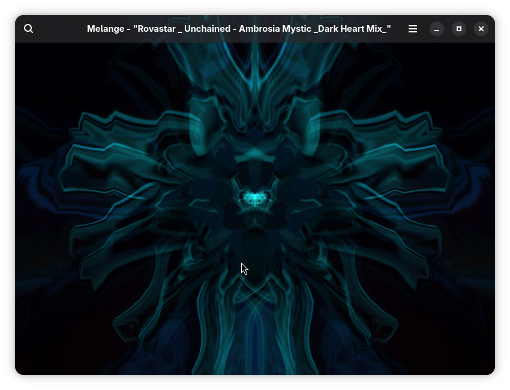
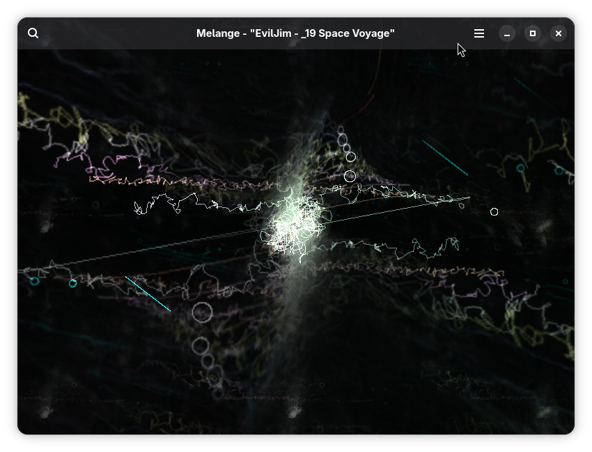
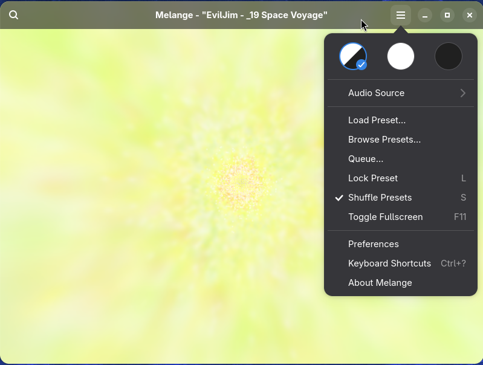
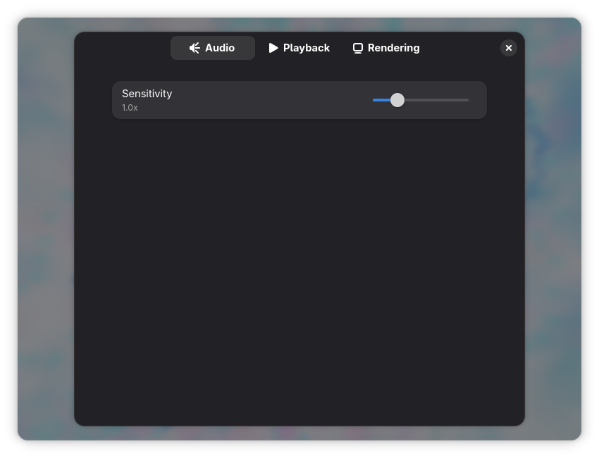
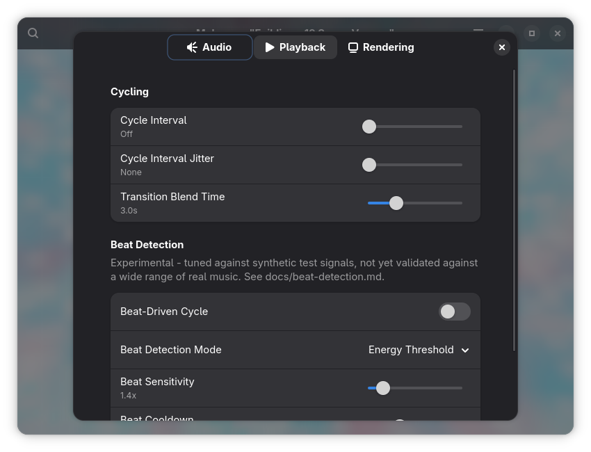
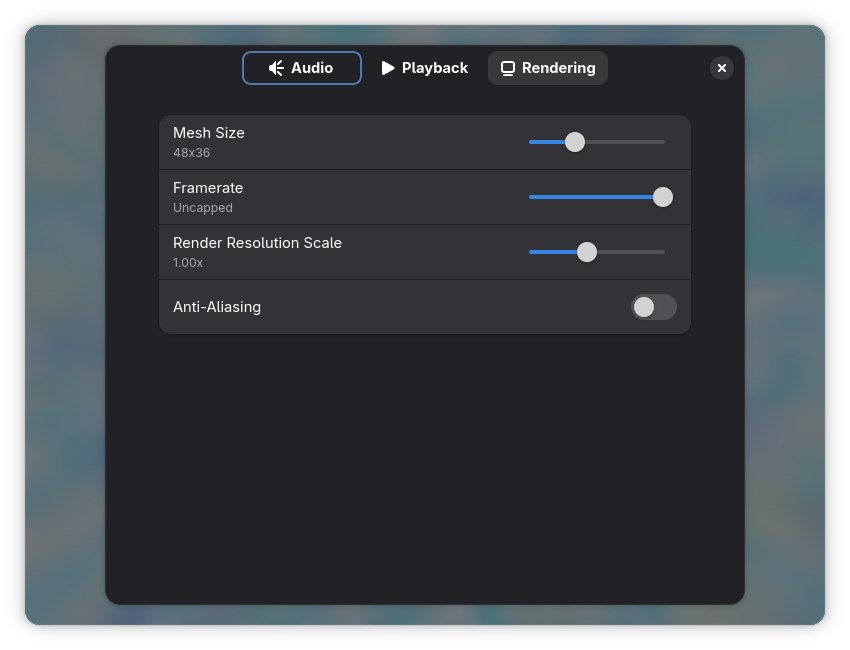

# Melange

A MilkDrop music visualizer for the Linux desktop, rendered natively
with [projectM](https://github.com/projectM-visualizer/projectm) in a
GTK4/libadwaita app. Reacts to system audio (or a microphone) in real
time, browses and loads MilkDrop (`.milk`) presets, and ships with
projectM's curated "Cream of the Crop" collection (~9,800 presets).

| | | |
| --- | --- | --- |
|  |  |  |

Preferences — Audio, Playback, and Rendering tabs:

| | | |
| --- | --- | --- |
|  |  |  |

## Features

- Native OpenGL MilkDrop rendering via libprojectM, driven by system
  audio (per-output capture) or a microphone
- Built-in preset library: projectM's
  [Cream of the Crop](https://github.com/projectM-visualizer/presets-cream-of-the-crop)
  collection (9,791 presets) and the MilkDrop texture pack, browsable
  as a Category › Subfolder tree or by search, with Presets/Favorites/
  Queue/Loaded tabs
- Favorite presets, from an on-canvas star or per-row in the browser,
  plus playlists and a play queue
- Load your own `.milk` presets with Load Preset… or by dropping them
  onto the window
- Adjustable sensitivity, transition blend time, mesh resolution,
  framerate cap, and render resolution scale
- Beat-driven preset changes using projectM's beat detection
- Shuffle and auto-cycle preset advancement, with proper back/forward
  history navigation
- Preset lock, on-canvas navigation arrows, window title showing the
  current preset name, and a native preset search dialog
- Fullscreen mode, draggable borderless window

## Keyboard shortcuts

| Shortcut | Action |
| --- | --- |
| `→` / `Space` | Next preset |
| `←` | Previous preset |
| `L` | Toggle preset lock |
| `S` | Toggle shuffle |
| `F` | Toggle favorite |
| `F11` | Toggle fullscreen |
| `Esc` | Exit fullscreen |
| `Ctrl+O` | Load preset file |
| `Ctrl+F` | Browse presets |
| `Q` | Show queue |
| `Ctrl+M` | New mirror window |
| `Ctrl+Shift+M` | Close all mirrors |
| `Ctrl+,` | Preferences |
| `Ctrl+?` | Show keyboard shortcuts |
| `Ctrl+Q` | Quit |

Cycle interval, transition blend time, beat-driven cycling, mesh size,
sensitivity, framerate and render resolution scale are all adjusted from
the Preferences dialog (hamburger menu → Preferences), grouped into
Audio/Playback/Rendering tabs.

## Building

Melange is a [Flatpak](https://flatpak.org/) app, built with Meson. The
flatpak manifest also builds libprojectM 4.1.8 (with a small patch in
`flatpak/` so it can draw into a GTK widget) and downloads the preset
collection and texture pack at pinned versions; the presets are packed
into a single zip that projectM reads from directly.

```sh
flatpak-builder --user --install --force-clean build-dir com.cameronlp.Melange.json
flatpak run com.cameronlp.Melange
```

Unit tests for the preset navigation logic: `python3 -m unittest discover tests`.

## Credits

- [projectM](https://github.com/projectM-visualizer/projectm) — the
  native MilkDrop renderer (libprojectM, LGPL-2.1)
- [ISOSCELES](https://github.com/projectM-visualizer/presets-cream-of-the-crop)
  — the "Cream of the Crop" preset collection; the presets themselves
  remain the work of their many authors
- The [MilkDrop texture pack](https://github.com/projectM-visualizer/presets-milkdrop-texture-pack)
- [Ryan Geiss](https://www.geisswerks.com/milkdrop/) — MilkDrop
- Earlier versions used [Butterchurn](https://github.com/jberg/butterchurn)
  by [Jordan Berg](https://github.com/jberg) and the
  [baron](https://github.com/uvmain/butterchurn-presets-baron) preset pack
- The DVD logo used in the DVD Bounce visualizer window is
  [Wikimedia Commons' File:DVD_logo.svg](https://commons.wikimedia.org/wiki/File:DVD_logo.svg),
  public domain (below the threshold of originality for copyright)
- Tux, also selectable in the DVD Bounce window, is
  [Larry Ewing](mailto:lewing@isc.tamu.edu)'s original artwork, created
  with [The GIMP](https://www.gimp.org/) — used here per its usual
  permission terms (free to use/modify with credit to Larry Ewing and
  The GIMP)

## License

GPL-3.0-or-later - see [COPYING](COPYING).
